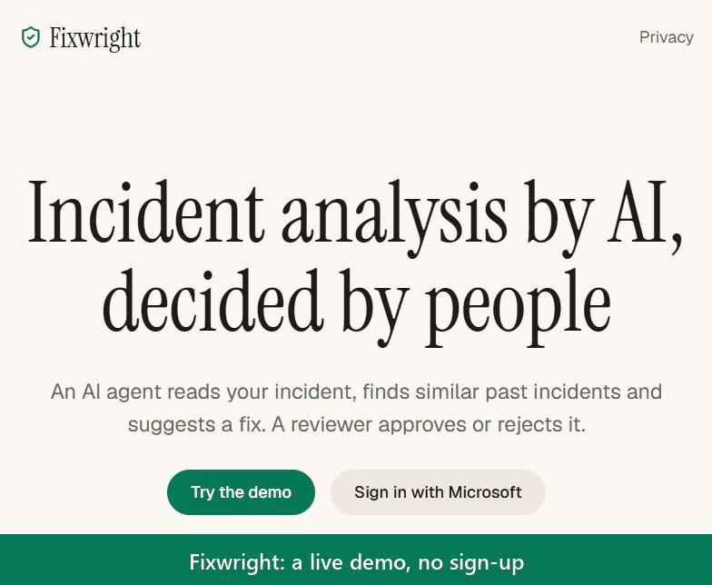
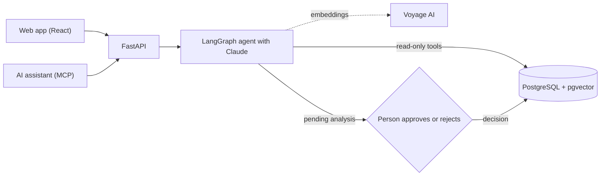
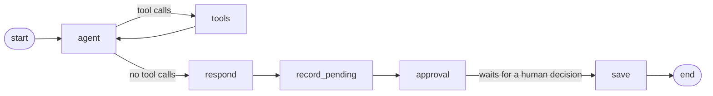
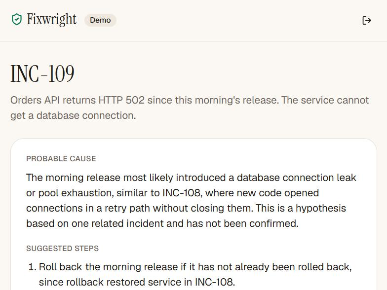
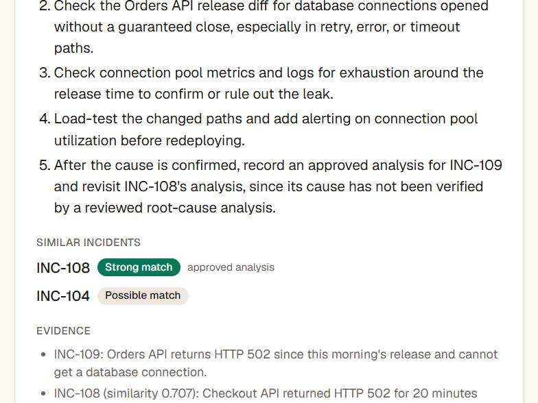
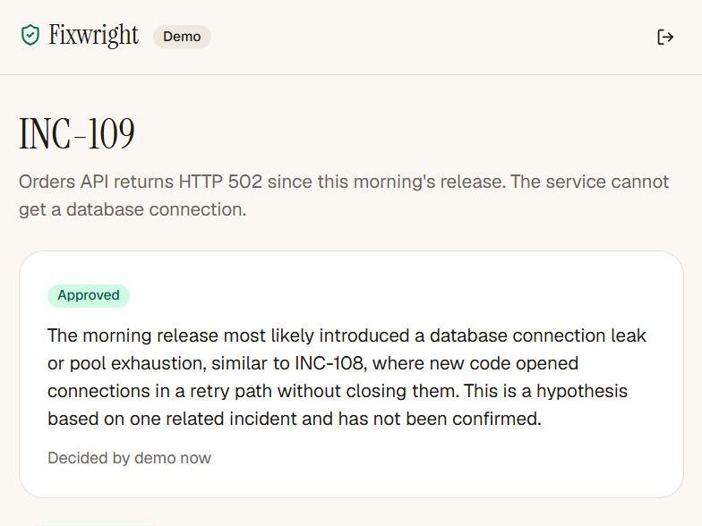

# Fixwright

**An AI agent analyzes IT incidents. A person decides.**

When an incident comes in, a LangGraph agent reads it, searches past incidents by meaning, and writes a probable cause, suggested steps, and the evidence behind them. Then it stops. A person approves or rejects the analysis, and only approved analyses are ever shown to the agent again.

**Try it:** [fixwright.onrender.com](https://fixwright.onrender.com) and click **Try the demo**. No sign-up. It runs on free tiers, so the first load can take up to a minute while the service wakes up.

> This repository is a showcase. The source code is private, and I am happy to walk through it in an interview.

## The problem

The same incident keeps coming back, and the fix is buried in a ticket someone closed last year. An AI agent can find that ticket in seconds, but it can also be confidently wrong. If a wrong answer gets saved and reused, every later analysis builds on it.

Fixwright keeps a person in charge of what becomes knowledge:

1. **Describe** what went wrong.
2. **Analyze:** the agent searches past incidents and suggests a cause and next steps, marking anything it could not confirm.
3. **Decide:** a reviewer approves or rejects. Only approved analyses are reused as evidence. Rejected ones are kept as an audit trail and never reach the agent.

## How it works

The agent itself is a small graph:

- **Two read-only tools.** `get_incident` reads an incident. `search_similar_incidents` runs a vector search over past incidents and attaches the latest *approved* analysis of each match. The agent cannot write anything.
- **Structured output.** The final answer is a typed object (probable cause, suggested steps, evidence), not free text.
- **Pauses for a person.** The graph stops with LangGraph `interrupt()`. Its state is stored in PostgreSQL, so the decision can come hours later or after a restart.
- **First decision wins.** If two reviewers decide at the same moment, one database update succeeds and the other gets `409 Conflict`.

| The agent's analysis | Similar incidents and evidence |
|---|---|
|  |  |

## Measured, not guessed

Both evaluations run against the real models, on demand, outside CI.

**Similar incident search.** 16 labeled incidents and 10 queries written in different words, two of them with no related incident:

| Similarity threshold | Precision | Recall | F1 |
|---|---|---|---|
| 0.40 | 0.56 | 1.00 | 0.72 |
| **0.45 (chosen)** | **0.71** | **0.94** | **0.81** |
| 0.50 | 0.88 | 0.83 | 0.86 |
| 0.55 | 1.00 | 0.61 | 0.76 |

F1 peaks at 0.50, but I chose 0.45 on purpose: the model can ignore a weak match it sees, but it cannot use a relevant incident the search left out.

**Full agent.** Four scenarios, each run three times, graded by code checks and an LLM judge: did it search, cite the right past incidents, reuse the approved cause, avoid anything from a rejected analysis, and mark guesses as unconfirmed? Result: **60 of 60 checks passed.** The wording changed from run to run, the behavior did not.

## Production basics

- **Sign-in:** SSO with Microsoft Entra ID (OpenID Connect with PKCE, handled on the server), plus a one-click demo session. Roles come only from signed token claims.
- **Five roles:** `demo`, `analyst`, `reviewer`, `admin`, `api`. An analyst can start analyses but cannot approve them, a reviewer can.
- **Use from AI assistants:** an MCP server gives assistants four hand-picked tools (list, create, analyze, decide). Update and delete are left out on purpose, and the decision still needs a person's explicit yes.
- **Security defaults:** signed `HttpOnly` session cookies, a CSRF header for browser requests, a strict Content-Security-Policy, constant-time key comparison, and settings that fail closed when a secret is missing.
- **A demo that is safe to share:** daily limits checked before any model call, and demo data deleted automatically after 7 days, including the agent's stored state.
- **Resilient search:** if the embedding service is down, incidents are still saved and their vectors are filled in later.
- **Tests and CI:** 181 backend tests against a real PostgreSQL database and 95 web app tests. The model is replaced by a fake in tests, so CI never calls a paid API. Lint, type check, and build run on every pull request.
- **Tracing:** every agent run can be followed step by step in LangSmith (model calls, tool calls, tokens, cost, latency).
- **Deployment:** Docker on Render with Neon PostgreSQL in Frankfurt, deployed on every merge to `main`. Dependabot keeps dependencies current.

## Tech stack

| Area | Tools |
|---|---|
| Agent | LangGraph, LangChain, Anthropic Claude (Haiku 5.5), structured output, Postgres checkpointer |
| Search | PostgreSQL with pgvector (HNSW, cosine), Voyage AI embeddings |
| Backend | Python, FastAPI, Pydantic, psycopg (plain SQL, no ORM) |
| Web app | React, TypeScript, Vite, Tailwind CSS, shadcn/ui, TanStack Query |
| Identity | Microsoft Entra ID, MSAL |
| Integrations | MCP (Model Context Protocol) server |
| Quality | pytest, Vitest, evaluation scripts, LangSmith |
| Delivery | Docker, GitHub Actions, Render, Neon, Dependabot |

## Honest limits

- The evaluation sets are small, and the judge is the same model as the agent.
- The free tier sleeps when idle, so the first request after a pause is slow.
- Demo data is public. Please do not enter personal or confidential information.

---

Copyright (c) 2026 Çağkan Özçivit. All rights reserved.
